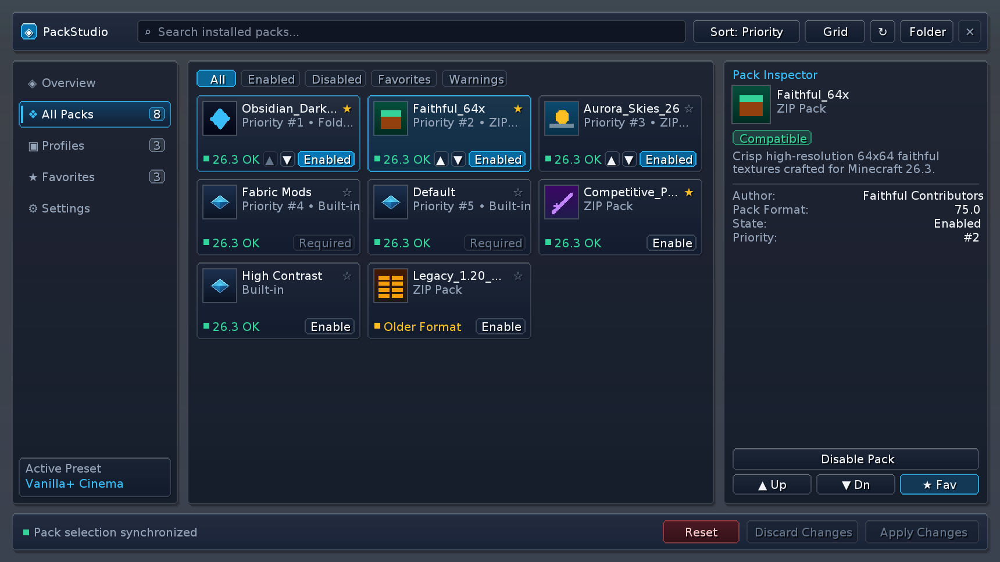
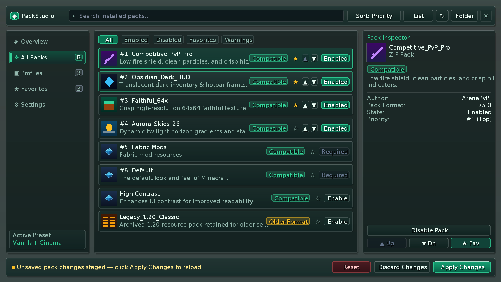
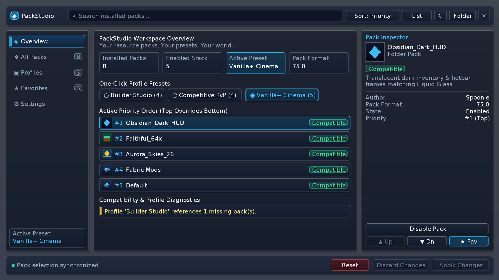
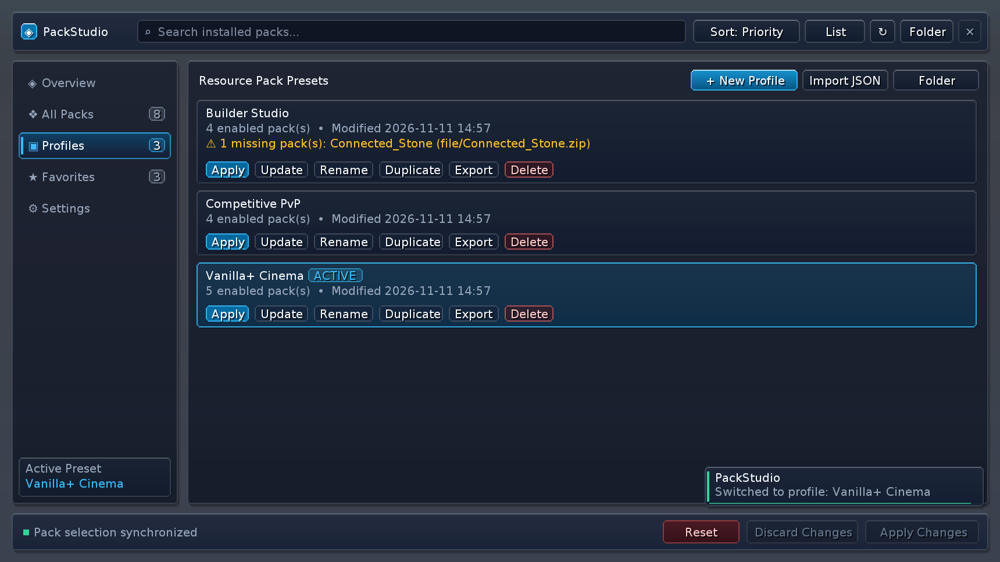
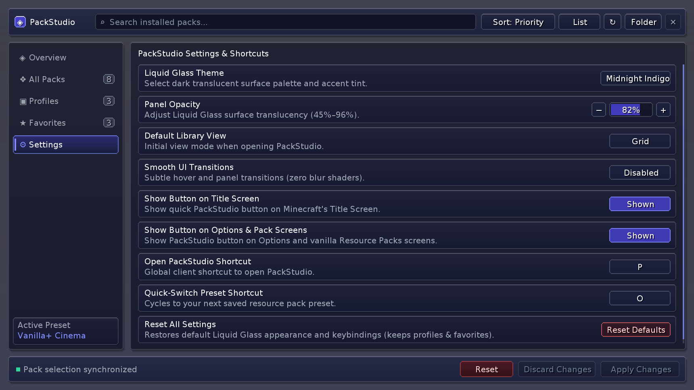

# PackStudio

> **Your resource packs. Your presets. Your world.**

**PackStudio** is a client-side **Minecraft Java Edition 26.X** Fabric mod (26.1, 26.1.1, 26.1.2, 26.2 and 26.3) that replaces clunky vanilla resource pack juggling with a refined **Liquid Glass** studio workspace. Browse ZIP and folder packs in Grid or List mode, inspect authentic `pack.mcmeta` metadata, organize reusable presets, and switch entire resource pack stacks in a single click — directly inside Minecraft.

- **Minecraft**: `26.1`, `26.1.1`, `26.1.2`, `26.2`, `26.3` (unobfuscated Java Edition, one JAR per version)
- **Mod Loader**: Fabric Loader `0.20.1+`, with the official Fabric API build per version
- **Java Runtime**: Java `25`
- **Environment**: `100% Client-Side` (works on any singleplayer world or multiplayer server without server installation)
- **Zero Mixins & Zero Blur Shaders**: Built exclusively on public Minecraft & Fabric APIs (`GuiGraphicsExtractor`, `ScreenEvents`, `KeyMappingHelper`, `PackRepository`) for rock-solid compatibility with Sodium and modern optimization mods.

---

## Screenshots

### Resource Pack Library — Grid View (`Obsidian Cyan` Theme)


### Resource Pack Library — List View (`Frosted Emerald` Theme)


### Workspace Overview & One-Click Preset Bar


### Profile Manager & Missing-Pack Diagnostics


### Persistent Settings & SDL3 Shortcut Configuration (`Midnight Indigo` Theme)


---

## Core Features

### 1. Real Resource Pack Library
- Reads directly from Minecraft's native `PackRepository` — supporting `.zip` archives, unpacked folders, and built-in packs with zero fake entries.
- Asynchronous `pack.png` `DynamicTexture` icon caching and `pack.mcmeta` inspection on `Util.backgroundExecutor()` so the UI render thread never stalls.
- Instant **Search**, **Filter** (`All`, `Enabled`, `Disabled`, `Favorites`, `Warnings`), **Sort** (`Priority`, `Name A–Z`, `Name Z–A`, `Enabled First`, `Compatibility`), and **Grid / List** layout toggle.
- Explicit top-to-bottom priority ordering (`#1` overrides `#2`, etc.) that automatically translates to Minecraft's internal bottom-to-top `PackRepository` selection list while preserving pinned/required base packs.

### 2. Schema-Versioned Profile Manager
- **Create, Update, Rename, Duplicate, Delete, Export, and Import** presets (`PvP`, `Vanilla+`, `Builder`, `Performance`, etc.).
- Stored locally in `config/packstudio/profiles/<id>.json` using portable `PackRepository` IDs (never machine-specific absolute paths).
- **Honest Missing-Pack Handling**: If a pack referenced by a preset is deleted from `resourcepacks/`, PackStudio flags the missing pack explicitly and never silently substitutes a different pack.
- **Portable JSON Export & Import**: Exports clean JSON files to `config/packstudio/exports/` (and copies to clipboard) with strict schema validation and automatic duplicate disambiguation on import.

### 3. Transactional One-Click Profile Switching
- Validates the target profile, preserves exact priority order, updates `PackRepository`, and triggers `Minecraft.reloadResourcePacks()`.
- Confirms profile activation **only after resource reload completes**.
- Automatically restores the previous active pack selection and active profile ID if a resource reload fails.
- Includes an in-game **Quick-Switch Preset** shortcut (`O` by default) with native `SystemToast` feedback.

### 4. Pack Inspector & Smart Detection
- Displays authentic pack title, description, source type (`ZIP Pack` / `Folder Pack` / `Built-in`), compatibility status (`Compatible` / `Older Format` / `Newer Format`), state, and priority rank.
- Displays `Author` strictly when declared in `pack.mcmeta` (`Not specified` otherwise — never fabricated).
- Quarantines corrupted config or profile JSON files to timestamped `.corrupt.<timestamp>.bak` backups rather than crashing or silently erasing user files.

### 5. Liquid Glass Design System & Settings
- Three curated dark translucent themes: **Obsidian Cyan**, **Midnight Indigo**, and **Frosted Emerald**.
- Adjustable **Panel Opacity** (`45%`–`96%`), **Default Library View**, **Smooth UI Transitions** toggle, **Title/Options Launch Button** toggles, and interactive **SDL3 Keyboard Shortcut** rebinding.
- Responsive `AdaptiveLayout` across GUI scales (`1x`–`4x`) and window sizes.

---

## Default Controls & Access

| Action | Default Binding / Location |
| :--- | :--- |
| **Open PackStudio** | `P` (configurable in PackStudio Settings & Minecraft Controls) |
| **Quick-Switch Next Preset** | `O` (configurable in PackStudio Settings & Minecraft Controls) |
| **Menu Launch Button** | Top-right `PackStudio` button on Title Screen, Options Screen, and Resource Packs Screen (toggleable in Settings) |
| **Library Keyboard Navigation** | `↑` / `↓` to select pack, `Space` / `Enter` to stage enable/disable, `Esc` to close (prompts if unsaved changes exist) |

---

## Installation

Pick **only** the release folder that matches your Minecraft version — each JAR declares an exact
Minecraft dependency range and will not load on another version.

| Minecraft | Release file | Fabric API |
| :--- | :--- | :--- |
| `26.1` | [`releases/26.1/PackStudio-26.1.jar`](releases/26.1/PackStudio-26.1.jar) | `0.155.3+26.1.2` |
| `26.1.1` | [`releases/26.1.1/PackStudio-26.1.1.jar`](releases/26.1.1/PackStudio-26.1.1.jar) | `0.155.3+26.1.2` |
| `26.1.2` | [`releases/26.1.2/PackStudio-26.1.2.jar`](releases/26.1.2/PackStudio-26.1.2.jar) | `0.155.3+26.1.2` |
| `26.2` | [`releases/26.2/PackStudio-26.2.jar`](releases/26.2/PackStudio-26.2.jar) | `0.161.0+26.2` |
| `26.3` | [`releases/26.3/PackStudio-26.3.jar`](releases/26.3/PackStudio-26.3.jar) | `0.165.2+26.3` |

1. Install your **Minecraft Java Edition** version with **Fabric Loader `0.20.1+`** (running on **Java 25**).
2. Place the matching **Fabric API** build into your `.minecraft/mods/` folder.
3. Place the matching **PackStudio** JAR into `.minecraft/mods/`.
4. Launch Minecraft and press **`P`** or click the **`PackStudio`** button on the Title / Options / Resource Packs screen.

Release notes and per-version changelogs live in [`releases/RELEASE_NOTES_26X.md`](releases/RELEASE_NOTES_26X.md)
and `releases/<version>/CHANGELOG.md`.

See [`docs/BUILD_AND_INSTALL.md`](docs/BUILD_AND_INSTALL.md) for detailed installation and troubleshooting steps.

---

## Building from Source

PackStudio uses the official unobfuscated Minecraft **Fabric Loom `1.19`** toolchain with **Gradle `9.8.2`**
and **Java `25`**. One shared codebase builds every supported Minecraft version:

```bash
# Requires JDK 25 (e.g. Eclipse Temurin 25)
./gradlew clean build                          # defaults to Minecraft 26.3
./gradlew clean build -Pminecraft_version=26.2 # one target per build
```

`-Pminecraft_version` selects the Minecraft version, the official Fabric API / Loader versions, the API
compatibility layer and the `fabric.mod.json` dependency range for that target. Compiled artifacts are emitted to
`build/libs/packstudio-1.0.0+mc<version>.jar`; verified release files are collected into
`releases/<version>/PackStudio-<version>.jar`.

How the version differences are handled is documented in
[`docs/MULTIVERSION_COMPATIBILITY.md`](docs/MULTIVERSION_COMPATIBILITY.md).

Run the automated JUnit 5 test suite with:

```bash
./gradlew test
```

---

## Architecture Overview

```text
src/main/java/com/packstudio/
├── core/            # Mod constants, identifiers, paths, PackStudioBootstrap lifecycle
├── client/          # PackStudioClient entrypoint, SDL3 KeyMappings, NotificationManager
│   └── screen/      # PackStudioScreen, AdaptiveLayout
│       ├── components/  # GlassButton, GlassTabButton, GlassSearchField, GlassModalDialog, GlassNotificationOverlay
│       └── panels/      # OverviewPanel, PackLibraryPanel, PackDetailsPanel, ProfilesPanel, SettingsPanel
├── compatibility/   # PackMetadataInspector, CompatibilityAnalyzer, ProfileValidator
├── manager/         # ConfigManager, PackRepositoryManager, PackIconCache, ProfileManager, ProfileApplier
├── model/           # PackStudioConfig, PackProfile, PackEntry, enums & theme presets
├── storage/         # Atomic UTF-8 JsonStorage with corrupted-file .bak quarantine
└── util/            # GlassRenderUtil, AnimationUtil, TextFormatUtil
```

## Storage Locations

PackStudio never modifies or overwrites files inside `.minecraft/resourcepacks/`. All mod state lives cleanly under `.minecraft/config/packstudio/`:
- `config/packstudio/config.json` — Schema-versioned appearance, favorites, active preset ID, and shortcut settings
- `config/packstudio/profiles/*.json` — Saved resource pack presets
- `config/packstudio/exports/*.json` — Portable exported preset JSON files

---

## Storefront Listings

- **Modrinth Description**: [`docs/MODRINTH.md`](docs/MODRINTH.md)
- **CurseForge Description**: [`docs/CURSEFORGE.md`](docs/CURSEFORGE.md)
- **Changelog**: [`CHANGELOG.md`](CHANGELOG.md)

## License

Licensed under the [MIT License](LICENSE).
