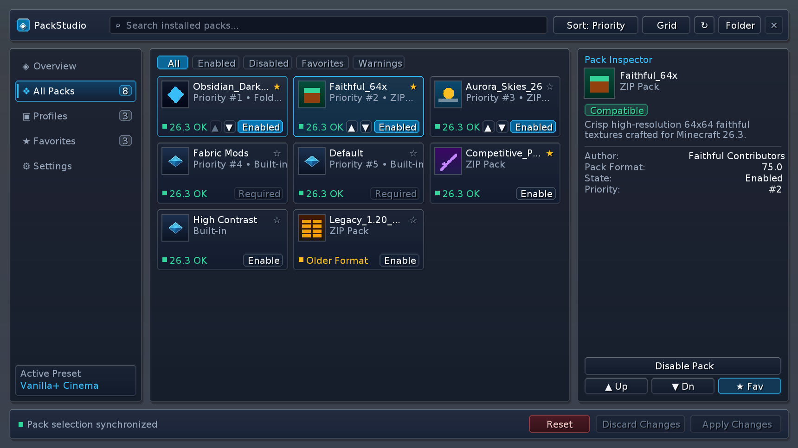
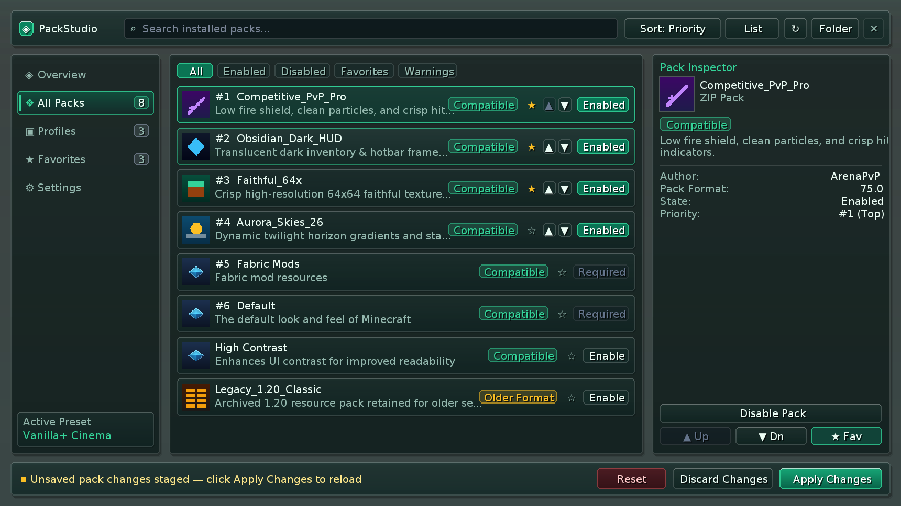
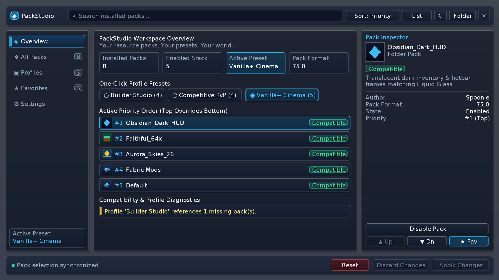
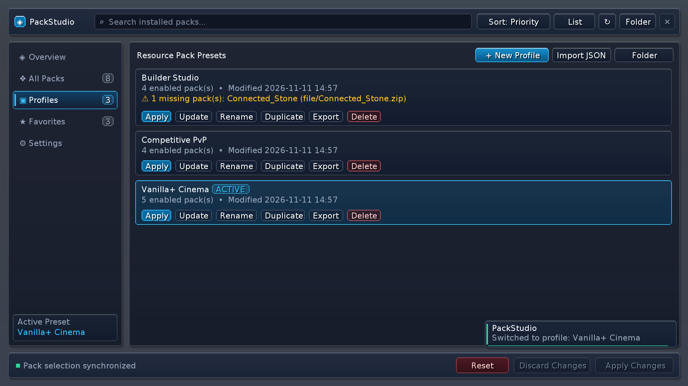
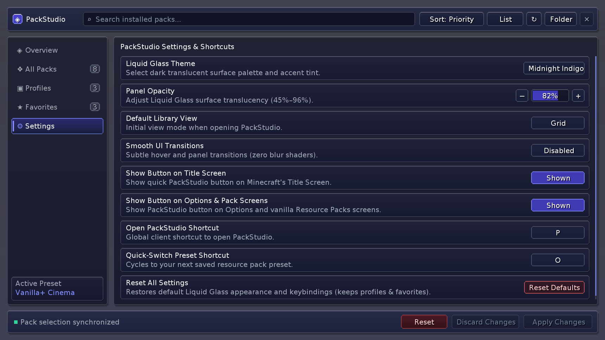

# PackStudio `1.0.0+mc26.1`

> **Your resource packs. Your presets. Your world.**

Client-side **Minecraft Java Edition `26.1` (Fabric)** mod — a modern, native **minimalist** resource pack
library and one-click preset manager built directly into the Minecraft client.

> **This release is only for Minecraft `26.1`.** PackStudio ships one independent release per Minecraft
> version; every other version has its own release with its own JAR and its own change list.

---

## All supported versions

| Minecraft | Release | Fabric API | Status |
| :--- | :--- | :--- | :--- |
| `26.1` | **`1.0.0+mc26.1`** | `0.155.3+26.1.2` | **This page** |
| `26.1.1` | [`1.0.0+mc26.1.1`](https://github.com/Spoonle/PackStudio/releases/tag/v1.0.0%2Bmc26.1.1) | `0.155.3+26.1.2` | Available |
| `26.1.2` | [`1.0.0+mc26.1.2`](https://github.com/Spoonle/PackStudio/releases/tag/v1.0.0%2Bmc26.1.2) | `0.155.3+26.1.2` | Available |
| `26.2` | [`1.0.0+mc26.2`](https://github.com/Spoonle/PackStudio/releases/tag/v1.0.0%2Bmc26.2) | `0.161.0+26.2` | Available |
| `26.3` | [`1.0.0+mc26.3`](https://github.com/Spoonle/PackStudio/releases/tag/v1.0.0%2Bmc26.3) | `0.165.2+26.3` | Available |

Each release contains exactly one Minecraft version — there is no universal JAR, and each JAR declares an
exact Minecraft dependency range so a mismatched install fails immediately instead of misbehaving in game.

---

## Quick Installation

1. Install **Minecraft Java Edition `26.1`** with **[Fabric Loader `0.20.1+`](https://fabricmc.net/use/installer/)** (running on **Java `25`**).
2. Download **[Fabric API](https://modrinth.com/mod/fabric-api)** (`0.155.3+26.1.2` or newer) and place it in your `.minecraft/mods/` folder.
3. Scroll down to **Assets**, download **`packstudio-fabric-26.1-1.0.0.jar`**, and drop it into `.minecraft/mods/`.
4. Launch Minecraft and press **`P`** — or click **`PackStudio`** in the top-right corner of the **Title Screen**, **Options Screen**, or **Resource Packs Screen**.

> **100% Client-Side**: Works on singleplayer worlds and any multiplayer server (vanilla, Fabric, Paper, Velocity) without server installation.

---

## Compatibility & Requirements

| Component | Version / Requirement |
| :--- | :--- |
| **Minecraft** | `26.1` (Java Edition) — dependency range `>=26.1 <26.1.1` |
| **Mod Loader** | Fabric Loader `>= 0.20.1` |
| **Required Dependency** | Fabric API `0.155.3+26.1.2` or newer |
| **Java Runtime** | Java `25` |
| **Side / Compatibility** | Client-only (`Zero Mixins`, `Zero Shaders` — **Sodium** compatible) |
| **API family** | `26.1` (shared codebase + one version-specific compatibility layer) |

---

## Screenshots

| Resource Pack Library (Grid — *Obsidian Cyan*) | Resource Pack Library (List — *Frosted Emerald*) |
| :---: | :---: |
|  |  |

| Overview & One-Click Presets | Profile Manager & Missing-Pack Diagnostics |
| :---: | :---: |
|  |  |

| Persistent Settings & Shortcuts (*Midnight Indigo*) |
| :---: |
|  |

---

## What's changed in this build (`1.0.0+mc26.1`)

- First 26.X target built on the pre-26.2 client API (`Minecraft.screen` / `Minecraft.setScreen`).
- Resource-pack `pack.mcmeta` / `pack.png` read through `Pack.open()` → `PackResources` (no `PackMetadataResources` yet).
- Keyboard bindings use `InputConstants.Type.KEYSYM`; folders open via `Util.getPlatform().openUri`.
- Official Fabric API build for 26.1 / 26.1.1 / 26.1.2 is `0.155.3+26.1.2`.

### Version differences across the whole 26.X line

Every target is the same mod: the same Minimalist UI, the same features, the same behaviour. Only the four
Minecraft APIs that actually differ between 26.1 and 26.3 are implemented per API family, behind one small
`com.packstudio.compat` seam:

- **Client screen access** — `Minecraft.screen` / `setScreen` (26.1), `Minecraft.gui` (26.2+).
- **Pack metadata** — `Pack.open()` → `PackResources` (26.1–26.2), `Pack.openMetadata()` → `PackMetadataResources` (26.3).
- **Key mapping type** — `InputConstants.Type.KEYSYM` (26.1–26.2), `InputConstants.Type.KEYBOARD` (26.3).
- **Opening folders** — `Util.getPlatform().openUri(uri)` (26.1–26.2), `Blaze3D.openPath` (26.3).

- **Minecraft `26.1`** — `1.0.0+mc26.1`
  - First 26.X target built on the pre-26.2 client API (`Minecraft.screen` / `Minecraft.setScreen`).
  - Resource-pack `pack.mcmeta` / `pack.png` read through `Pack.open()` → `PackResources` (no `PackMetadataResources` yet).
  - Keyboard bindings use `InputConstants.Type.KEYSYM`; folders open via `Util.getPlatform().openUri`.
  - Official Fabric API build for 26.1 / 26.1.1 / 26.1.2 is `0.155.3+26.1.2`.
- **Minecraft `26.1.1`** — `1.0.0+mc26.1.1`
  - Same API family as 26.1; official Fabric API `0.155.3+26.1.2` covers 26.1, 26.1.1 and 26.1.2.
  - Dependency metadata is pinned to `>=26.1.1 <26.1.2`, so this JAR loads only on 26.1.1.
- **Minecraft `26.1.2`** — `1.0.0+mc26.1.2`
  - Same API family as 26.1; official Fabric API `0.155.3+26.1.2`.
  - Dependency metadata is pinned to `>=26.1.2 <26.2`.
- **Minecraft `26.2`** — `1.0.0+mc26.2`
  - Uses the new `Minecraft.gui` client holder (`gui.screen()` / `gui.setScreen()`).
  - Still the pre-26.3 pack metadata API (`Pack.open()` → `PackResources`) and `InputConstants.Type.KEYSYM`.
  - Official Fabric API build for 26.2 is `0.161.0+26.2`.
- **Minecraft `26.3`** — `1.0.0+mc26.3`
  - Baseline release: Minecraft `26.3`, Fabric Loader `0.20.1`, Fabric API `0.165.2+26.3`, Loom `1.19-SNAPSHOT`, Java 25.
  - Uses `Pack.openMetadata()` → `PackMetadataResources`, `InputConstants.Type.KEYBOARD` and `Blaze3D.openPath`.
  - First stable PackStudio release; the previously shipped `1.0.0+mc26.3` JAR is unchanged.

---

## Features

### Resource Pack Library (`All Packs` & `Favorites`)
- Discovers `.zip` archives, unpacked folders, and built-in packs directly from Minecraft's native `PackRepository` (no fake entries).
- Asynchronous `pack.png` `DynamicTexture` decoding and `pack.mcmeta` inspection on `Util.backgroundExecutor()` so the UI thread never blocks.
- Real-time search, filter pills (`All`, `Enabled`, `Disabled`, `Favorites`, `Warnings`), 5 sort modes, **Grid / List** layout toggle, favorites, and top-to-bottom priority ordering (`#1` overrides `#2` while keeping pinned base packs intact).

### Schema-Versioned Profile Manager (`config/packstudio/profiles/`)
- **Create, Update, Rename, Duplicate, Delete, Export, and Import** presets (`PvP`, `Vanilla+`, `Builder`, `Performance`, etc.) using portable pack IDs.
- **Honest Missing-Pack Detection**: Deleted packs referenced by a preset are flagged clearly (`⚠ N missing pack(s)`) and never silently replaced.
- **Safe Storage**: Atomic JSON writes (`JsonStorage`) and automatic `.corrupt.<timestamp>.bak` backup quarantine for damaged JSON files; never modifies user pack files.

### Transactional One-Click Profile Switching
- Validates the preset, applies exact priority order via `PackRepository#setSelected`, and triggers `Minecraft#reloadResourcePacks()`.
- Confirms profile activation **strictly after reload completion** and automatically restores your previous configuration if reload fails.

### Pack Inspector & Minimalist Settings
- Displays authentic pack descriptions, authors (strictly when declared in `pack.mcmeta`), pack formats, compatibility badges, state, and priority rank.
- Three dark themes (*Obsidian Cyan*, *Midnight Indigo*, *Frosted Emerald*), adjustable opacity (`45%`–`96%`), default view mode, smooth animation toggle, launch button toggles, and interactive SDL3 shortcut rebinding.

### Default Controls
- **`P`** — Open PackStudio
- **`O`** — Quick-Switch to next saved preset (with native toast feedback)
- **`↑` / `↓` / `Space` / `Esc`** — Keyboard library navigation & unsaved-changes guard

---

## Verification for this build

Built with the official unobfuscated Minecraft toolchain (Fabric Loom `1.19-SNAPSHOT`, Gradle `9.8.2`, Java `25`),
then verified in CI for **Minecraft `26.1`** specifically:

- dependency resolution against that version's real Minecraft, Fabric Loader and Fabric API;
- compilation of the shared sources plus the `26.1` compatibility layer;
- the full JUnit 5 suite (config persistence + corruption recovery, path traversal, real ZIP/folder pack
  discovery, apply + rollback, profile CRUD/import/export, widget render/input, adaptive layout, all tabs and
  views, entrypoint registration, target-identity and jar-metadata audits);
- a jar metadata audit (`tools/verify_release_jar.sh`) covering the Minecraft range, client-only flag, Java 25
  minimum, real Fabric API lower bound, entrypoint and build identity.

**Not verified (requires a real Minecraft client):** GPU rendering and texture upload at real GUI scales, a live
resource-pack reload of a running game, real SDL key capture, and OS folder dialogs / native toasts. Run the
manual smoke test in [`docs/VERIFICATION_26X.md`](https://github.com/Spoonle/PackStudio/blob/main/docs/VERIFICATION_26X.md)
before relying on those.

---

## Attached Assets

- **`packstudio-fabric-26.1-1.0.0.jar`** — playable client mod JAR *(drop into `.minecraft/mods/`)*
- **`packstudio-fabric-26.1-1.0.0-sources.jar`** — developer Java 25 sources archive
- **`SHA256SUMS.txt`** — checksum manifest for the attached files
- **`CHANGELOG.md`** — version-specific change list

---

## Links

- [All PackStudio releases](https://github.com/Spoonle/PackStudio/releases) · [Build & install guide](https://github.com/Spoonle/PackStudio/blob/main/docs/BUILD_AND_INSTALL.md) · [Compatibility & architecture](https://github.com/Spoonle/PackStudio/blob/main/docs/MULTIVERSION_COMPATIBILITY.md) · [Verification record](https://github.com/Spoonle/PackStudio/blob/main/docs/VERIFICATION_26X.md)
- [Report an issue](https://github.com/Spoonle/PackStudio/issues) · [Changelog](https://github.com/Spoonle/PackStudio/blob/main/CHANGELOG.md)
