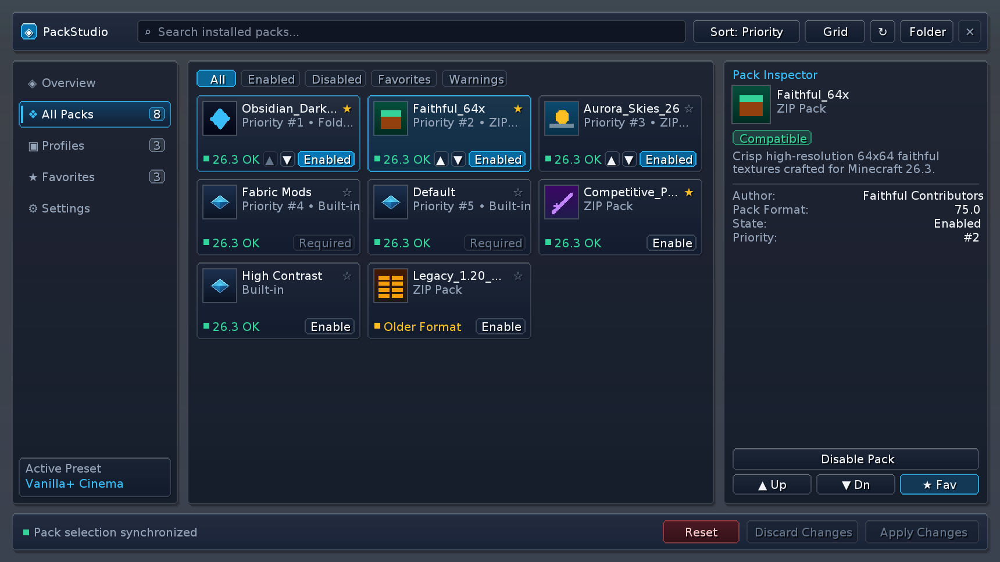
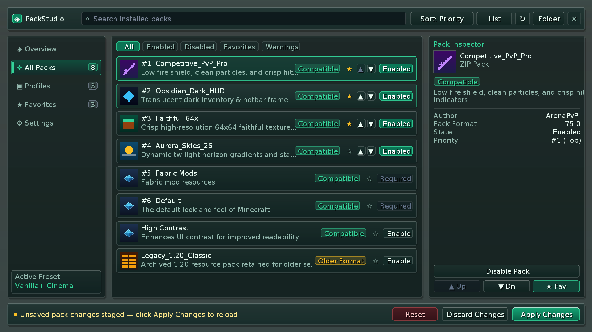
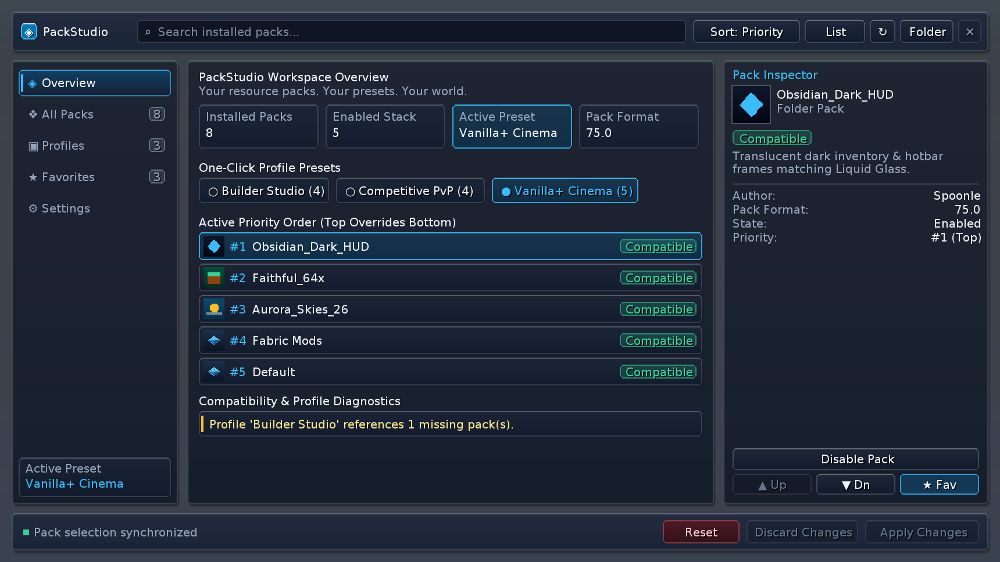
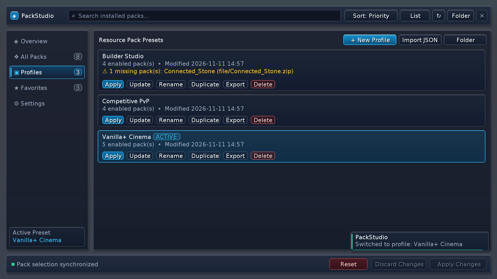
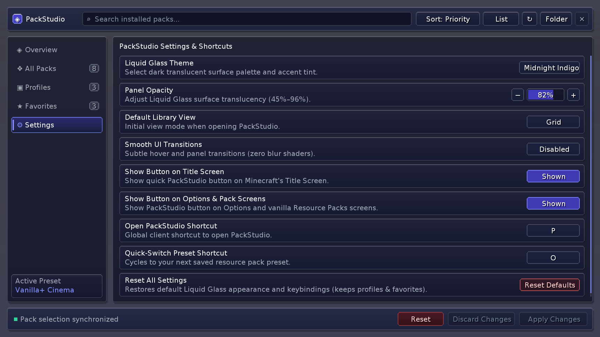

# PackStudio `1.0.0+mc26.3`

> **Your resource packs. Your presets. Your world.**

First stable release of **PackStudio** for **Minecraft Java Edition `26.3` (Fabric)** — a modern, native **Liquid Glass** resource pack library and one-click preset manager integrated directly into the Minecraft client.

---

## Direct Download

- **[Download `packstudio-1.0.0+mc26.3.jar` (148 KB — Client Mod JAR for Minecraft 26.3 Fabric)](https://github.com/Spoonle/PackStudio/raw/v1.0.0%2Bmc26.3/releases/packstudio-1.0.0%2Bmc26.3.jar)**
  - **SHA-256**: `58fd11ccb81b7d2fb3463ca29267acd45eb9141532a40bc43f4d0b2676442332`
- **[Download `packstudio-1.0.0+mc26.3-sources.jar` (77 KB — Developer Sources JAR)](https://github.com/Spoonle/PackStudio/raw/main/releases/packstudio-1.0.0%2Bmc26.3-sources.jar)**
  - **SHA-256**: `59bf595dc6f66fd356ceae0d82a585c8a63316f71af210a3cfa8ac624081a019`
- **[View `SHA256SUMS.txt`](https://github.com/Spoonle/PackStudio/raw/main/releases/SHA256SUMS.txt)**

---

## Quick Installation

1. Install **Minecraft Java Edition `26.3`** with **[Fabric Loader `0.20.1+`](https://fabricmc.net/use/installer/)** (running on **Java `25`**).
2. Download **[Fabric API](https://modrinth.com/mod/fabric-api)** (`0.165.2+26.3` or newer) and place it in your `.minecraft/mods/` folder.
3. Download **[`packstudio-1.0.0+mc26.3.jar`](https://github.com/Spoonle/PackStudio/raw/v1.0.0%2Bmc26.3/releases/packstudio-1.0.0%2Bmc26.3.jar)** and drop it into `.minecraft/mods/`.
4. Launch Minecraft and press **`P`** — or click **`PackStudio`** in the top-right corner of the **Title Screen**, **Options Screen**, or **Resource Packs Screen**.

> **100% Client-Side**: Works on singleplayer worlds and any multiplayer server (vanilla, Fabric, Paper, Velocity) without server installation.

---

## Compatibility & Requirements

| Component | Version / Requirement |
| :--- | :--- |
| **Minecraft** | `26.3` (Java Edition) |
| **Mod Loader** | Fabric Loader `>= 0.20.1` |
| **Required Dependency** | Fabric API (`0.165.2+26.3+`) |
| **Java Runtime** | Java `25` |
| **Side / Compatibility** | Client-only (`Zero Mixins`, `Zero Blur Shaders` — **Sodium** compatible) |

---

## Screenshots

| Resource Pack Library (Grid — *Obsidian Cyan*) | Resource Pack Library (List — *Frosted Emerald*) |
| :---: | :---: |
|  |  |

| Overview & One-Click Presets | Profile Manager & Missing-Pack Diagnostics |
| :---: | :---: |
|  |  |

| Persistent Settings & Shortcuts (*Midnight Indigo*) |
| :---: |
|  |

---

## Features & Release Notes (`1.0.0+mc26.3`)

### Resource Pack Library (`All Packs` & `Favorites`)
- Discovers `.zip` archives, unpacked folders, and built-in packs directly from Minecraft's native `PackRepository` (no fake entries).
- Asynchronous `pack.png` `DynamicTexture` decoding and `pack.mcmeta` inspection on `Util.backgroundExecutor()` so the UI thread never blocks.
- Real-time search, filter pills (`All`, `Enabled`, `Disabled`, `Favorites`, `Warnings`), 5 sort modes, **Grid / List** layout toggle, favorites, and top-to-bottom priority ordering (`#1` overrides `#2` while keeping pinned base packs intact).

### Schema-Versioned Profile Manager (`config/packstudio/profiles/`)
- **Create, Update, Rename, Duplicate, Delete, Export, and Import** presets (`PvP`, `Vanilla+`, `Builder`, `Performance`, etc.) using portable pack IDs.
- **Honest Missing-Pack Detection**: Deleted packs referenced by a preset are flagged clearly (`⚠ N missing pack(s)`) and never silently replaced.
- **Safe Storage**: Atomic JSON writes (`JsonStorage`) and automatic `.corrupt.<timestamp>.bak` backup quarantine for damaged JSON files; never modifies user pack files.

### Transactional One-Click Profile Switching
- Validates the preset, applies exact priority order via `PackRepository#setSelected`, and triggers `Minecraft#reloadResourcePacks()`.
- Confirms profile activation **strictly after reload completion** and automatically restores your previous configuration if reload fails.

### Pack Inspector & Liquid Glass Settings
- Displays authentic pack descriptions, authors (strictly when declared in `pack.mcmeta`), pack formats, compatibility badges, state, and priority rank.
- Three dark translucent themes (*Obsidian Cyan*, *Midnight Indigo*, *Frosted Emerald*), adjustable opacity (`45%`–`96%`), default view mode, smooth animation toggle, launch button toggles, and interactive SDL3 shortcut rebinding.

### Default Controls
- **`P`** — Open PackStudio
- **`O`** — Quick-Switch to next saved preset (with native toast feedback)
- **`↑` / `↓` / `Space` / `Esc`** — Keyboard library navigation & unsaved-changes guard
